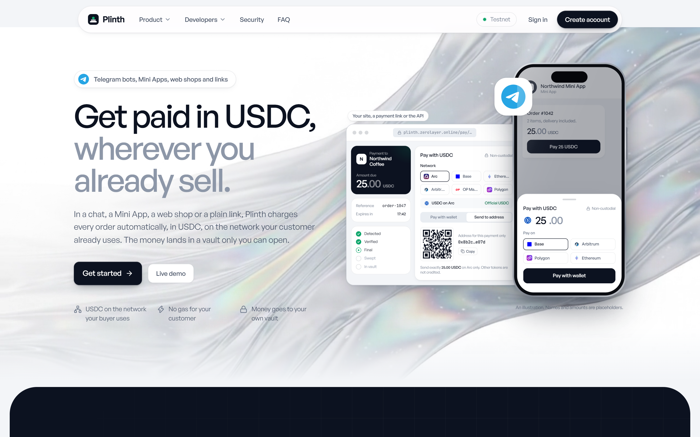
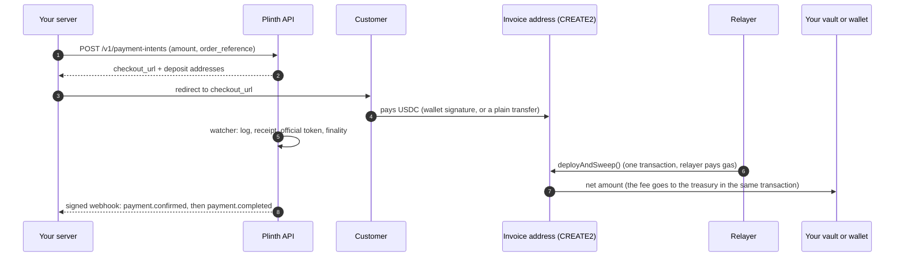
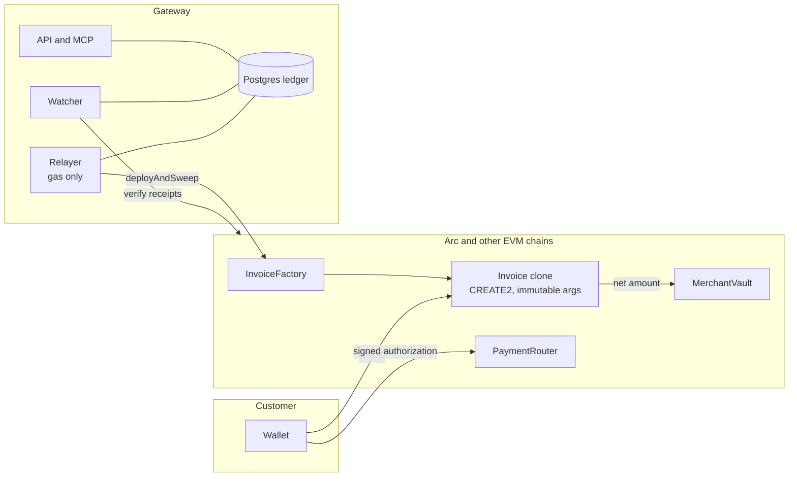

<div align="center">

# Plinth

**Non-custodial stablecoin payments. Get paid in USDC and EURC, wherever you already sell.**

A payment gateway where every payment gets its own address, the chain proves the payment, and the money goes to **your** vault or **your** wallet. Built on **Arc**.

[**Live site**](https://plinth.zerolayer.online) · [**MCP server**](docs/mcp.md) · [**Docs**](docs/README.md) · [**API guide**](docs/api-guide.md) · [**Arc mainnet contracts**](#live-on-arc-mainnet)



</div>

---

## Contents

1. [Why Plinth](#why-plinth)
2. [How a payment works](#how-a-payment-works)
3. [Features](#features)
4. [Live on Arc mainnet](#live-on-arc-mainnet)
5. [Three ways to be paid](#three-ways-to-be-paid)
6. [Fees](#fees)
7. [AI-native: the hosted MCP server](#ai-native-the-hosted-mcp-server)
8. [Networks and tokens](#networks-and-tokens)
9. [Architecture](#architecture)
10. [Repository layout](#repository-layout)
11. [Quick start](#quick-start)
12. [Quality: what was tested](#quality-what-was-tested)
13. [Security and status](#security-and-status)
14. [Documentation](#documentation)

## Why Plinth

Accepting stablecoins usually means one of two compromises: a custodial processor that holds your balance, or a hand-rolled "send to this wallet" page where you match transfers to orders yourself.

Plinth removes both. Each order gets a **unique deposit address that exists before any contract does** (a counterfactual CREATE2 address), so there is nothing to fund and nothing to babysit. A watcher verifies the transfer on-chain, and a restricted relayer pays the gas to sweep it to its destination. The gateway holds **no key that can move merchant funds**.

- **For merchants:** one API call per order, a hosted checkout, signed webhooks, payment links and invoices, a dashboard, and your money lands in an account you control.
- **For customers:** pay from a connected wallet with one gasless signature (EIP-3009), or just send USDC to the address or QR code.
- **For developers and AI assistants:** a REST API, a hosted [MCP server](#ai-native-the-hosted-mcp-server) with 29 tools, and `llms.txt`.

## How a payment works



The address is **computed offline** and cross-checked against the deployed factory's `predict()` before a customer ever sees it. `sweep()` takes no arguments, so nobody, including the gateway, can choose a recipient.

## Features

| | |
| --- | --- |
| **Payments** | Unique address per payment per network, partial / repeated / late / over / wrong-token payments handled, reorgs reversed, expiry (20 minutes by default) |
| **Checkout** | Hosted page, wallet checkout (gasless, EIP-3009) and address / QR checkout, live status from the backend only |
| **Merchant tools** | Payment links, numbered invoices, refunds verified on-chain, webhooks (signed, retried, idempotent), ledger, settlements, audit log, team roles |
| **Tokens** | USDC on every network, EURC on Arc, each with its own contract set and vault |
| **Payout modes** | Vault, direct to your own wallet, or (operator opt-in) custodial |
| **Fee** | 0.20% by default, capped at **1% by the contract**, taken inside the settlement transaction |
| **AI-native** | Hosted MCP server (29 tools), `llms.txt`, integration playbook, ready prompts |
| **Reliability** | Idempotent API, persisted raw transactions, fee replacement, nonce recovery, kill switch, deployment self-check every 5 minutes |

## Live on Arc mainnet

The contracts are deployed on **Arc** (chain id `5042`), byte-verified against the build, and approved for production. Source of truth: [`deployments/arc-mainnet.json`](deployments/arc-mainnet.json).

| Contract | USDC set | EURC set |
| --- | --- | --- |
| VaultFactory | [`0xeBc9…D56D`](https://explorer.arc.io/address/0xeBc902Cee74345DD23f63E2f132f81E5fBE1D56D) | [`0x0A31…B2Ea`](https://explorer.arc.io/address/0x0A310C2cC7c445D33fe91586240992b6f432B2ea) |
| InvoiceDeposit (implementation) | [`0x7950…ea84`](https://explorer.arc.io/address/0x795090A656f472cdddeF8cF367A4ee446b39ea84) | [`0x8e33…7a9f`](https://explorer.arc.io/address/0x8e3326B7638b388717B821aA225a5E2c19477a9f) |
| InvoiceFactory | [`0xb106…a168`](https://explorer.arc.io/address/0xb10655458F990335b6339d0c95D9755B5CACa168) | [`0xc8a6…ad65`](https://explorer.arc.io/address/0xc8a620C0dD6370DeB0254848D3877160f057ad65) |
| PaymentRouter | [`0xf154…0728`](https://explorer.arc.io/address/0xf154b3Da58EEa004d5B05a90fF5BA595F8A40728) | [`0x134C…5Dfb`](https://explorer.arc.io/address/0x134C791F1aFC4f51D19d698Fae981D6663905Dfb) |

Tokens: USDC `0x3600…0000` (Arc's native USDC, 6-decimal interface) and EURC `0xbEf5…21c1`. Treasury (fee recipient): `0xC0d1…Adc2`. The API reads the deployed contracts back from the chain (token, chain id, version, treasury, fee cap) and closes the network if anything differs.

## Three ways to be paid

| Mode | Where the money goes | Control |
| --- | --- | --- |
| **Vault** (default) | A `MerchantVault` contract only your owner wallet can withdraw from; optional delayed forwarding rules | Your owner key. Use a multisig or hardware wallet |
| **Direct** | Straight to a payout wallet you proved you control (EIP-4361 signature, fresh sign-in, cooldown) | Your wallet key |
| **Custodial** | Into the platform's custody wallet; you withdraw to a proven wallet, manually or on a schedule | Off by default; an operator must enable it |

The destination is part of each invoice address, so changing mode only affects **new** payments. The vault's delay applies to forwarding rules only; the owner key can always withdraw at once.

## Fees

The platform fee is **20 bps (0.20%)**, rounded down in the token's own units, taken in the same transaction that settles the payment and sent to the treasury. The contract fixes a **maximum of 100 bps (1%)** that cannot be changed after deployment. If the treasury transfer ever fails, the merchant receives the full amount and the event `FeeSkipped` records it: a hostile treasury can never block a settlement. The fee is not refunded. Details: [docs/architecture.md](docs/architecture.md).

## AI-native: the hosted MCP server

Plinth ships an MCP server so an AI assistant can add checkout to your project and run your payments in plain English. It is **hosted**: one URL, your key in a header, nothing to install.

```bash
# Claude Code
claude mcp add --transport http plinth https://plinth-api.zerolayer.online/mcp --header "Authorization: Bearer sk_test_..."
```

```json
{ "mcpServers": { "plinth": { "url": "https://plinth-api.zerolayer.online/mcp", "headers": { "Authorization": "Bearer sk_test_..." } } } }
```

**29 tools** over payments, payment links, invoices, refunds, webhooks and reports, plus the integration playbook, a ready prompt and resources. There is **no tool that changes where money goes**, creates keys or edits the team. Full reference: [docs/mcp.md](docs/mcp.md).

## Networks and tokens

The registry holds **26 networks**: Arc, Base, Arbitrum, OP, Ethereum, Polygon and 18 more Circle-native USDC chains, each with its chain id, token addresses, EIP-712 domain, finality rule and log window **verified read-only against the live chain**. Only Arc has contracts deployed today; every other network stays closed until it is deployed and approved. Table, verification method and what is pending: [docs/networks.md](docs/networks.md).

## Architecture



- **Contracts** (Solidity 0.8.28, Foundry, OpenZeppelin 5): ERC-1167 clones with immutable arguments; no proxies, no admin, no upgrade path.
- **Engine**: payment status is *derived* from verified facts; the ledger is idempotency-keyed; webhooks are signed and retried.
- **Relayer**: simulates before signing, quotes live fees, enforces per-network spend limits, persists the signed transaction before broadcasting.

Full design: [docs/architecture.md](docs/architecture.md). Threats and trade-offs: [docs/threat-model.md](docs/threat-model.md).

## Repository layout

| Path | What |
| --- | --- |
| `contracts/` | Foundry project: `MerchantVault`, `VaultFactory`, `InvoiceDeposit`, `InvoiceFactory`, `PaymentRouter`, tests, deploy script |
| `packages/shared` | Network registry, fee and token model, state machine, money, schemas |
| `packages/blockchain` | viem adapter: offline CREATE2 derivation, EIP-3009, log scanning, dev chain |
| `packages/db` | Drizzle schema and migrations (Postgres; PGlite for local and tests) |
| `packages/engine` | Payments, ledger, settlement planner, relayer, watcher, refunds, payout wallets, custody, auth |
| `packages/mcp` | The MCP server (tools, Streamable HTTP handler, stdio) |
| `apps/api` | Fastify REST API (`/v1`), the hosted MCP endpoint (`/mcp`), OpenAPI |
| `apps/worker` | Background loop: watcher, relayer, forwarding, expiry, webhooks |
| `apps/web` | Next.js: marketing site, hosted checkout, merchant dashboard |
| `deployments/` | Verified per-network deployment records (public addresses only) |
| `scripts/` | Dev stack, deploy finalize and approve, network verification, end-to-end run |
| `docs/` | Architecture, threat model, API guide, runbooks, review, MCP, networks |

## Quick start

Requirements: Node 22 or newer, pnpm, [Foundry](https://getfoundry.sh).

```bash
pnpm install
(cd contracts && forge build) && pnpm abis     # compile and export ABIs
pnpm dev:stack                                 # local chain + contracts + embedded Postgres + API :4000 + worker + demo merchant
pnpm web                                       # dashboard and checkout at http://localhost:3000 (separate terminal)
```

`dev:stack` prints a demo login, a test API key and the local contract addresses. Create a payment:

```bash
curl -X POST localhost:4000/v1/payment-intents -H "Authorization: Bearer <test key>" \
  -H "Idempotency-Key: demo-1" -H "Content-Type: application/json" -d '{"amount":"25.00","order_reference":"DEMO-1"}'
```

Open the returned `checkout_url`. Deploying contracts to a network: [docs/DEPLOY-HANDOFF.md](docs/DEPLOY-HANDOFF.md) and [docs/deploy-testnet.md](docs/deploy-testnet.md).

## Quality: what was tested

| Suite | Result |
| --- | --- |
| Foundry (`pnpm test:contracts`) | **87 passed**: unit, fuzz, invariants, fee split and fail-open fee, vault and direct kinds, router nonce binding, two-token deployments, gas-griefing fuzz |
| Heavy campaign | 20,000 fuzz runs per test and 1,000 invariant runs at depth 100: no counterexample |
| Static analysis | Slither, 80 detectors: no high or medium finding |
| TypeScript (`pnpm test`) | engine **120**, api **28**, blockchain **23**, shared **23**, mcp **8**, db **6**, all passing |
| End to end (`pnpm e2e:local`) | vault, address payment, wallet payment, direct payout and EURC on a local chain, with merchant and treasury balances checked on-chain |
| Network probes (`pnpm verify:networks`) | chain id, token identity, EIP-712 domain, EIP-3009 and permit selectors, log window |

What was *not* done is listed in [docs/verification.md](docs/verification.md).

## Security and status

- **Not independently audited.** An internal review (tools, findings, fixes) is in [docs/security-review.md](docs/security-review.md); it is not an audit. Start with small amounts.
- A compromised backend cannot take funds already at issued addresses or in vaults, but it **could hand out new checkout addresses** that pay an attacker. The threat model says exactly what is and is not protected.
- Keys: the relayer key is a gas-only environment key; there is no KMS/HSM yet. Custody is off by default.
- Report a vulnerability privately; see the Security page of the site.

## Documentation

[**docs/README.md**](docs/README.md) indexes everything: [architecture](docs/architecture.md) · [API guide](docs/api-guide.md) + [OpenAPI](docs/openapi.json) · [MCP](docs/mcp.md) · [networks](docs/networks.md) · [operations](docs/operations.md) · [threat model](docs/threat-model.md) · [security review](docs/security-review.md) · [verification](docs/verification.md) · [deploy handoff](docs/DEPLOY-HANDOFF.md).

---

<div align="center">

Built for **Arc**. License: not yet specified.

</div>
